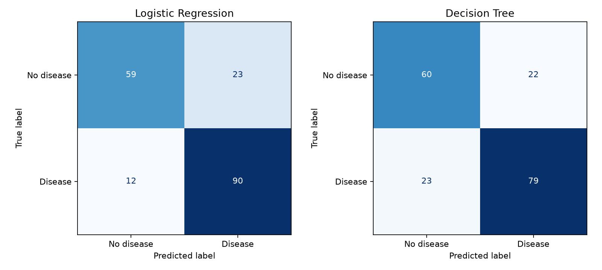
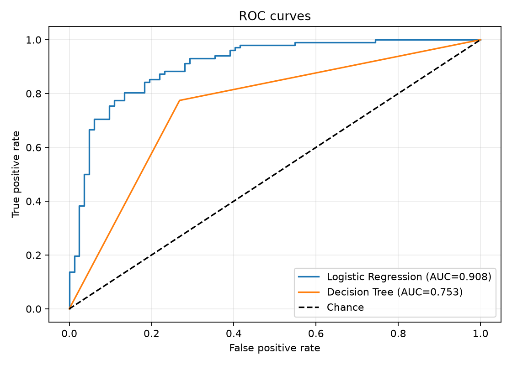
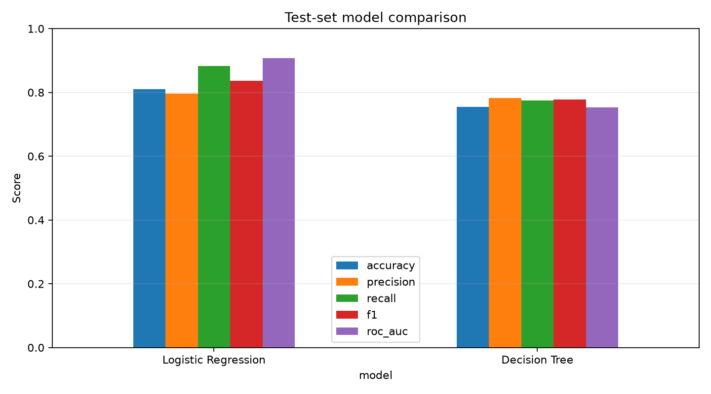

# Week 4 Capstone: Heart Disease Prediction

## Objective

Compare Logistic Regression and a Decision Tree for a binary heart-disease target. `num=0` means no diagnosis; values `1` through `4` are grouped as disease present. This is a classroom exercise, not a clinical diagnostic tool.

## Dataset and attribution

The supplied `data/heart_disease_uci.csv` is the 920-row four-site combined copy distributed on [Kaggle by Redwan Karim Sony](https://www.kaggle.com/datasets/redwankarimsony/heart-disease-data), with records from Cleveland, Hungary, Switzerland, and VA Long Beach. The underlying [UCI Heart Disease dataset](https://archive.ics.uci.edu/dataset/45/heart+disease) is listed under CC BY 4.0; attribution: Detrano et al., Heart Disease Data Set, UCI Machine Learning Repository, DOI [10.24432/C52P4X](https://doi.org/10.24432/C52P4X). The supplied file is included for reproducibility. The Kaggle page's separate license terms could not be verified, so this attribution does not assert a separately confirmed license for that re-hosted copy.

The input has 920 rows and 16 columns. `num` is the source target. The script drops `id` and `dataset` from the predictors, then uses the remaining 13 clinical features. `?` values are treated as missing. The raw target counts and missing values are saved in `outputs/dataset_summary.json`. `num=0` occurs 411 times; positive values total 509. The binary classes are moderately balanced: 411 no-disease and 509 disease records.

## Setup and run

From this folder, create a virtual environment and install dependencies:

```powershell
py -m venv .venv
.\.venv\Scripts\Activate.ps1
python -m pip install -r requirements.txt
python train_evaluate.py
```

The 80/20 stratified split uses seed 42. Numeric values are median-imputed with missingness indicators; categorical values use most-frequent imputation and one-hot encoding. Logistic Regression also uses standard scaling. Each transformation is fitted inside its model pipeline on training data only. The same test rows are used for both models.

## Evaluation

Accuracy is the overall fraction correct; precision measures how often positive predictions are correct; recall measures how many positive cases are found; F1 is the harmonic mean of precision and recall. ROC-AUC measures ranking across thresholds. Scores below are calculated from the held-out 184-row test split; the script writes them to `outputs/model_metrics.csv`.

| Model | Accuracy | Precision | Recall | F1 | ROC-AUC |
|---|---:|---:|---:|---:|---:|
| Logistic Regression | 0.8098 | 0.7965 | 0.8824 | 0.8372 | 0.9076 |
| Decision Tree | 0.7554 | 0.7822 | 0.7745 | 0.7783 | 0.7531 |

Logistic Regression performs better on this split across all five reported metrics. Confusion matrices (rows are actual labels, columns are predicted; order is no disease, disease): Logistic Regression `[[59, 23], [12, 90]]`; Decision Tree `[[60, 22], [23, 79]]`.

### Confusion matrices



### ROC curves



### Model comparison



## Presentation and generated files

`outputs/heart_disease_capstone.pptx` is an editable PowerPoint deck generated with the actual metrics and plots. `outputs/test_predictions.csv` records the held-out labels, predictions, and positive-class probabilities. All outputs can be regenerated with `python train_evaluate.py`.

## Limitations

This is a small, historical, multi-site dataset with substantial missingness, especially in `ca`, `thal`, and `slope`. We exclude the hospital/source field to reduce site shortcuts, but a random split across sites is not external validation. Performance estimates can vary with the split and may not generalize to current patients. This educational model is not a clinical diagnostic tool.
